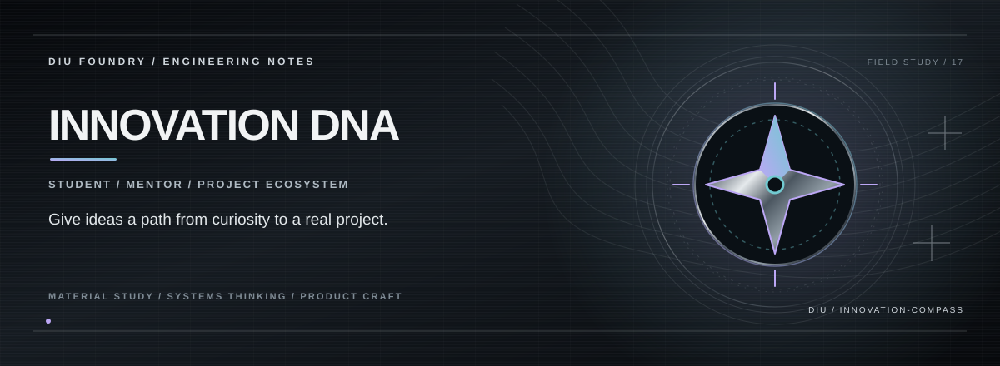

# INNOVATION DNA

> **AI / STUDENT INNOVATION ECOSYSTEM.**

## THE PREMISE

Innovation DNA imagines a connected environment for students, mentors, faculty, projects, learning and startup pathways — one ecosystem instead of scattered opportunities.

## THE EXPERIENCE

**Ideas need paths.**  
**Mentorship should connect to action.**  
**A project should have a life beyond the submission date.**

## THE SYSTEM

Next.js and Framer Motion provide a motion-rich application shell. Planned service boundaries include authentication, structured project data, storage and model-assisted mentoring.

## THE STACK

Next.js · React · TypeScript · Tailwind CSS · Framer Motion

## RUN

```bash
npm install
npm run dev
```

## PROJECT STATE

**Frontend innovation-ecosystem prototype**

Implemented behaviour is documented separately from future integrations so the project story stays honest as the product evolves.

---

<p align="center"><strong>K. KISHOR KUMAR</strong><br><sub>ENGINEERING / PRODUCT / SYSTEMS</sub></p>
